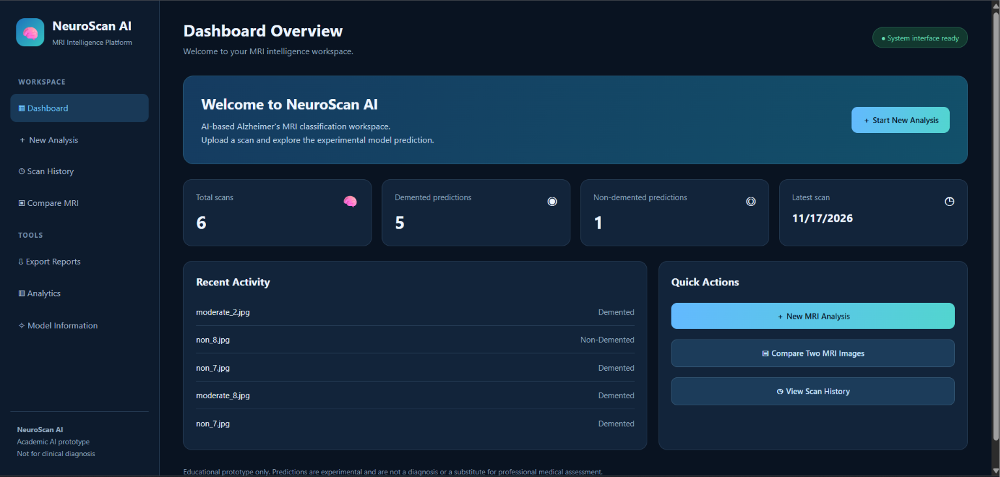
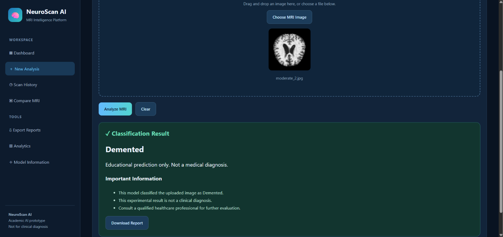
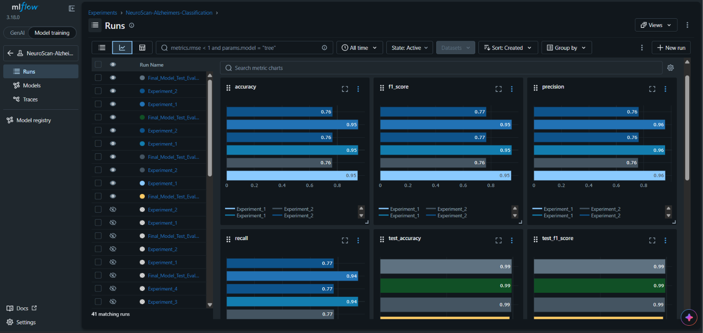
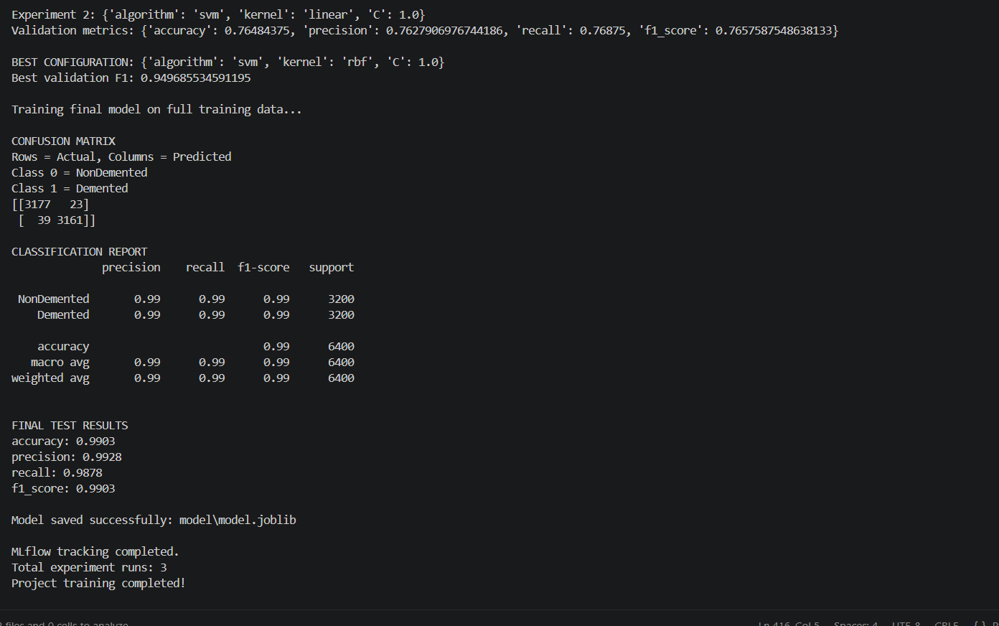
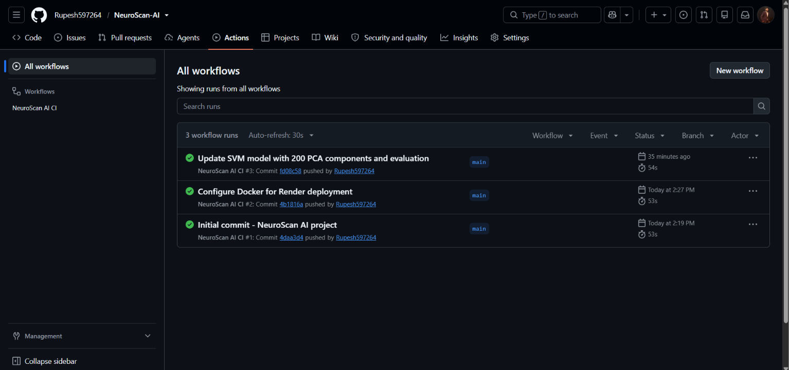

# NeuroScan AI
### AI-Based Alzheimer's MRI Classification System

NeuroScan AI is an educational AI-powered application that analyzes brain MRI images and classifies them into two categories: **NonDemented** and **Demented**.

The project uses image preprocessing, Principal Component Analysis (PCA), and Support Vector Machine (SVM) classification. It provides an interactive web dashboard where users can upload MRI images and view experimental predictions.

> **Disclaimer:** NeuroScan AI is an academic prototype. Its predictions are experimental and must not be used as a medical diagnosis or a substitute for professional medical assessment.

## Live Application

- **Live Demo:** https://neuroscan-ai-rain.onrender.com
- **GitHub Repository:** https://github.com/Rupesh597264/NeuroScan-AI

## Key Features

- MRI image upload and classification.
- Grayscale image preprocessing.
- Image resizing to 64 × 64 pixels.
- Pixel normalization and feature extraction.
- PCA-based dimensionality reduction.
- SVM and Random Forest model experiments.
- MLflow experiment tracking.
- FastAPI backend.
- Interactive dashboard with scan history and analytics.
- Docker containerization.
- Automated testing using Pytest.
- GitHub Actions CI workflow.
- Deployment on Render.

## Technology Stack

| Component | Technology |
|---|---|
| Programming Language | Python |
| Machine Learning | Scikit-learn |
| Image Processing | OpenCV |
| Dimensionality Reduction | PCA |
| Classification | SVM, Random Forest |
| Experiment Tracking | MLflow |
| Backend | FastAPI |
| Frontend | HTML, CSS, JavaScript |
| Model Serialization | Joblib |
| Testing | Pytest |
| Containerization | Docker |
| CI | GitHub Actions |
| Deployment | Render |

## Dataset

The project uses an Alzheimer's MRI image dataset organized into four original classes:

- MildDemented
- ModerateDemented
- NonDemented
- VeryMildDemented

The dataset is stored locally and is not included in this GitHub repository.

### Binary Class Mapping

| Original Class | Binary Label |
|---|---:|
| NonDemented | 0 |
| MildDemented | 1 |
| ModerateDemented | 1 |
| VeryMildDemented | 1 |

The dataset contains separate `train` and `test` folders, each organized by the four original class names.

## Image Preprocessing

The MRI images undergo the following preprocessing steps:

1. Images are loaded using OpenCV.
2. Images are converted into grayscale.
3. Images are resized to 64 × 64 pixels.
4. Pixel values are normalized to the range 0–1.
5. Each image is flattened into a feature vector containing 4096 pixel features.
6. StandardScaler is applied.
7. PCA reduces the feature dimensions before classification.

The selected model configuration uses 200 PCA components.

## Model Training and Evaluation

The project compares two machine learning algorithms:

- Support Vector Machine (SVM)
- Random Forest Classifier

SVM configurations with RBF and linear kernels are evaluated. Random Forest configurations with different numbers of trees are also evaluated.

The best configuration is selected using validation F1-score.

### Reported Best Model Results

| Metric | Score |
|---|---:|
| Accuracy | 99.03% |
| Precision | 99.28% |
| Recall | 98.78% |
| F1-score | 99.03% |

**Selected configuration:**
- Algorithm: SVM
- Kernel: RBF
- PCA Components: 200
- C: 1.0

### Confusion Matrix

| Actual / Predicted | NonDemented | Demented |
|---|---:|---:|
| NonDemented | 3177 | 23 |
| Demented | 39 | 3161 |

These are the reported results from the current experimental test run. Independent validation is necessary before making claims about clinical performance.

## MLflow Experiment Tracking

MLflow is used to track model experiments, parameters, and evaluation metrics.

The tracked experiments include:
- SVM with RBF kernel.
- SVM with linear kernel.
- Random Forest with 100 estimators.
- Random Forest with 200 estimators.

The best model is saved using Joblib at:

`model/model.joblib`

## Project Structure

```text
NeuroScan-AI/
│
├── .github/
│   └── workflows/
│       └── ci.yml
│
├── model/
│   └── model.joblib
│
├── notebooks/
│   └── Project2.ipynb
│
├── static/
│   └── index.html
│
├── tests/
│   └── test_app.py
│
├── app.py
├── train.py
├── requirements.txt
├── requirements-serve.txt
├── Dockerfile
├── .dockerignore
└── .gitignore
```

The local dataset, virtual environment, MLflow tracking files, and other generated files are not included in the repository.

## Local Setup

### 1. Clone the repository

```bash
git clone https://github.com/Rupesh597264/NeuroScan-AI.git
cd NeuroScan-AI
```

### 2. Create a virtual environment

```bash
python -m venv venv
```

### 3. Activate the environment on Windows

```bash
venv\Scripts\activate
```

### 4. Install dependencies

```bash
pip install -r requirements.txt
```

### 5. Prepare the dataset

Place the dataset on your computer with this structure:

```text
Alzheimer_s Dataset/
│
├── train/
│   ├── MildDemented/
│   ├── ModerateDemented/
│   ├── NonDemented/
│   └── VeryMildDemented/
│
└── test/
    ├── MildDemented/
    ├── ModerateDemented/
    ├── NonDemented/
    └── VeryMildDemented/
```

### 6. Train the model

```bash
python train.py --data_dir "PATH_TO_DATASET" --algorithm all
```

To train the selected SVM configuration:

```bash
python train.py --data_dir "PATH_TO_DATASET" --algorithm svm --pca_components 200
```

### 7. Run the application

```bash
uvicorn app:app --reload
```

Open the application at:

`http://127.0.0.1:8000`

API documentation:

`http://127.0.0.1:8000/docs`

## Running Tests

Run the automated tests using:

```bash
python -m pytest tests/ -v
```

## Running with Docker

Build the Docker image:

```bash
docker build -t neuroscan-ai .
```

Run the container:

```bash
docker run -d -p 8000:8000 --name neuroscan-container neuroscan-ai
```

Open:

`http://localhost:8000`

## Continuous Integration

GitHub Actions is configured to run the project's CI workflow when changes are pushed to the main branch.

The workflow validates the project through dependency installation, model training, and automated tests.

## Deployment

The application is deployed on Render using Docker.

**Live URL:** https://neuroscan-ai-rain.onrender.com

## Future Scope

- Evaluation on additional independent MRI datasets.
- Improved image feature extraction.
- More extensive model comparisons.
- Further model interpretability and explainability.
- Validation with appropriate clinical expertise and datasets.

## Author

**Rupesh Saini**

GitHub: https://github.com/Rupesh597264

## Acknowledgement

This project was developed as part of an academic MLOps project, integrating machine learning, image processing, experiment tracking, API development, testing, containerization, and cloud deployment.
## Application Screenshots

### Dashboard


### MRI Prediction


### MLflow Experiment Tracking


### Confusion Matrix


### GitHub Actions CI
